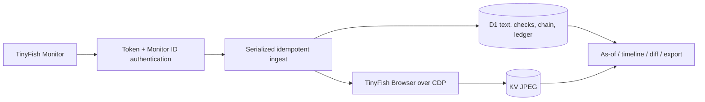

# Time Machine

A Monitor-backed, screenshot-backed version history for public web pages.

**Live:** https://tinyfish-time-machine.sundaysebasidian.workers.dev

The first recordings started November 3, 2026. This is an ongoing recording, not an archive of earlier dates. See [the live inventory](evidence/MONITORS.md) for current IDs and schedules, and [the production audit](evidence/live-audit.json) for reproducible verification results.

## How TinyFish does the work

| Primitive | Meaningful role | Conservative budget |
|---|---|---|
| Monitor | Runs all recurring page checks and posts their results to the authenticated webhook. Removing Monitor stops history collection. | $0.005 per completed check |
| Fetch | Verifies reachability and meaningful extracted content before allowing any URL to be tracked. Monitor baselines supply the first observed version. | Within free allowance |
| Browser | Captures the actual live page over CDP for each new normalized version, including the baseline, and immediately DELETEs the session. | Reserve $0.004 per session; $0.002/min documented rate |
| Search | Finds official pricing/terms pages from a company name in the add-page flow. Search results are live, not seeded examples. | Within free allowance |

Endpoint shapes were checked against https://docs.tinyfish.ai/llms-full.txt and the [Monitor](https://docs.tinyfish.ai/monitor/api-reference), [Fetch](https://docs.tinyfish.ai/fetch-api/reference), [Browser](https://docs.tinyfish.ai/browser-api/reference), and [Search](https://docs.tinyfish.ai/search-api/reference) references on November 3. Current Monitor webhooks include `outcome`, `diff` and optional `judgment`; this build preserves its own normalized comparison because it needs conservative noise filtering and reusable structured blocks. The original plan's claim that these fields are absent is outdated.

The Browser capability preflight produced a 166,152-byte JPEG and confirmed session termination with HTTP 204. R2 creation returned Cloudflare error 10042 (not enabled), so this deployment uses KV for JPEGs. The storage interface can be replaced with R2 when enabled; there is no hidden Cloudflare browser service or screenshot fee.

## Run locally

Requires Node 24+, npm and a Cloudflare account. No workspace packages are required.

```sh
npm ci
cp .env.example .dev.vars
# Fill .dev.vars with your own secrets; leave PAID_CALLS_ENABLED=false.
npx wrangler d1 execute tinyfish-time-machine --local --file schema.sql
npm run dev
```

`wrangler.toml` contains this deployment's resource IDs. For an independent deployment create your own D1 database and KV namespace, replace the IDs and Worker name/base URL, then:

```sh
npx wrangler d1 create tinyfish-time-machine
npx wrangler kv namespace create BLOBS
npx wrangler d1 execute tinyfish-time-machine --remote --file schema.sql
npx wrangler secret put TINYFISH_API_KEY
npx wrangler secret put ADMIN_TOKEN
npx wrangler secret put WEBHOOK_SECRET
npm run deploy
```

Generate long random admin/webhook secrets. Do not rotate the webhook secret without updating existing Monitor webhook URLs. `scripts/configure.ts` is an executor convenience: it reuses `.env.runtime.local` if present and uploads secrets through stdin, never command arguments. Local scripts accept `TINYFISH_API_KEY` from the environment or `.env.local`; the authorized main-checkout path is only a fallback for this worktree.

```sh
npm test
npm run typecheck
npm run check:browser # paid, explicit one-session capability test
npm run seed          # paid: Fetch-verify candidates, provision up to 24 Monitors
npm run audit:live    # reads live versions, hashes every image, checks APIs/auth
```

Seeding and auditing scripts use the deployment URL in the scripts and the admin token in gitignored `.env.runtime.local`. Change the URL when installing independently. Do not run the Browser preflight repeatedly: it reserves one call and writes its estimate to `.cost-log.jsonl`.

## API

No key is needed for read APIs. Public writes allow three active community slots, one addition per IP per UTC day, daily checks only, seven-day expiry, and the shared budget guard. Administrative actions require `Authorization: Bearer $ADMIN_TOKEN`. Each API result includes source and observation timestamps; as-of lookups mean **last observed version at or before the requested time**, not proof of the precise change time.

```sh
BASE=https://tinyfish-time-machine.sundaysebasidian.workers.dev
curl "$BASE/api/pages"
curl "$BASE/api/search?q=TinyFish"

# Any public HTTPS page with meaningful Fetch-readable content; not a hardcoded allowlist.
curl -X POST "$BASE/api/pages" -H 'Content-Type: application/json' \
  -d '{"url":"https://example.com/pricing","name":"Example pricing"}'

PAGE=f8016e28-b66c-4e1b-a07a-23b03102c0a6
curl "$BASE/api/pages/$PAGE/snapshots"
curl "$BASE/api/pages/$PAGE/as-of?at=2026-11-05T12%3A00%3A00Z"
curl "$BASE/api/pages/$PAGE/diff?from=2026-11-04T12%3A00%3A00Z&to=2026-11-06T12%3A00%3A00Z"
curl "$BASE/api/pages/$PAGE/export" -o history.json
curl "$BASE/api/changelog"
curl "$BASE/api/budget"
curl "$BASE/api/health"

# Real run-now: costs $0.005; ingestion records source=manual.
curl -X POST "$BASE/api/pages/$PAGE/check" -H "Authorization: Bearer $ADMIN_TOKEN"

# Explicit, budgeted recovery of a failed screenshot. Does not invent a version.
curl -X POST "$BASE/api/pages/$PAGE/screenshots/$SNAPSHOT/retry" \
  -H "Authorization: Bearer $ADMIN_TOKEN"
```

A date before the first baseline returns 404, never fabricated history. Diff returns `blocks: [{type: "added" | "removed" | "changed", before, after, words}]`, plus line counts. Each word part has `added`/`removed` flags. Text exports include raw and normalized content, run IDs, source URLs, screenshot URLs, hashes, capture times, check errors and chain links. Images are independently retrievable at `/api/screenshots/:snapshotId`.

The public change log includes only changed **scheduled** observations after the baseline. Manual checks and baseline creation do not masquerade as changes caught by the scheduler.

## Ingestion and integrity



The Worker authenticates webhooks with a page-scoped HMAC-SHA256 token and verifies `fetch_monitor_id`. Run IDs are unique, duplicate deliveries are acknowledged, and no-change runs add checks without snapshots. Text is saved before screenshot work is deferred. A Durable Object serializes short state mutations and budget reservations, while external Fetch/Browser requests run outside that queue. D1 batch transactions prevent partial ingestion. Observation timestamps increase monotonically even if two runs arrive in one millisecond.

Noise filtering drops standalone relative times, standalone clocks and short `updated:` labels, collapses whitespace, and strips known tracking parameters. It preserves prices, effective dates, substantive lines containing times, and the raw source text. Loading placeholders and bot challenges fail verification; they do not become invented empty changes.

The chain starts with `sha256("time-machine:" + pageId)` and links:

```
sha256(previousLink + "\n" + textSha + "\n" + (chainShotSha ?? "-") + "\n" + observedAt)
```

If a screenshot finishes before the next version, its hash is included in the newest chain link. If a later version already exists, the earlier image is stored with `late=1`, its own `shot_sha`, and a null `chain_shot_sha`, preserving the existing chain. The UI explicitly labels late images. “Verify evidence” recomputes text, chain links, and actual image bytes using Web Crypto in the client. These hashes detect corruption relative to an exported/trusted chain root; an operator who rewrites the complete database can rewrite the chain too. This is not independent notarization.

JPEGs capture a 1280×6000 viewport region, capped for cost and storage. They are actual browser images, not rendered markdown or recreated pages. Screenshot time is recorded separately from text observation time; a page can change between Fetch and Browser capture. KV may take time to propagate. Failures remain explicit in the timeline and can be retried by an administrator. The UI refreshes pending captures for 90 seconds.

## Budget and operation

Hard cap: **$4**. Stop threshold: **$3.20** (80%). All paid app calls reserve cost before execution; disabled calls still preserve observed text and mark the screenshot `paid_disabled`. Wallet checks are cached for five minutes and enforce a $3 floor. Browser reservations also have a $0.15 UTC-day cap. The production cost ledger lives in D1. Local executor calls write `.cost-log.jsonl`; `audit:live` exports the production ledger to gitignored `.cost-log.production.jsonl`.

Scheduled Monitors bill outside the Worker. Each creation therefore reserves its entire conservative schedule cost through November 17, including the baseline, without assuming any free 72-hour promotion. Fast pages run every six hours for the first three days, then the ten-minute maintenance cron changes them to daily. All other pages run daily from creation. This keeps the inventory live for the full period within the cap; keeping eight fast pages indefinitely would not.

The cron independently estimates elapsed check charges even if webhooks are lost, holds one inventory-wide check of headroom, pauses Monitors at the budget/end-date boundary, and deletes expired community Monitors only after retaining their local history. Deletion is confirmed with a 404 from TinyFish. The end date is November 17 at 23:59 PT. Guard reservations are conservative estimates, not exact invoices. The wallet is shared with other builds, so wallet balance movement cannot be attributed exclusively to this app.

Do not manually increase Monitor frequency outside the app: that would bypass its schedule projection. If cron fails, alert/reconcile in Cloudflare; a Worker cannot guarantee stopping an external billing schedule during a total infrastructure outage. TinyFish webhooks are best effort and no REST run-history endpoint is available, so lost deliveries cannot be fully backfilled.

## Readiness

Implemented: hosted Worker, 25+ useful curated monitors, real Fetch baselines, stored screenshots, public URL tracking, company search, structured diffs, as-of queries, export, public change log and client-side verification.

Still time-dependent: at least three days of live running and actual scheduled changes with images. Inspect `/api/changelog` after November 6 before submitting. More than five snapshots on Wikipedia/GitHub by November 10 is a validation target, not a result claimed today. The expiry cron has code and unit coverage of core guards; a real seven-day expiry has not elapsed. No submission, GitHub repository, push, LinkedIn post or Discord message has been made. Final styling and the submission video remain for the coordinating task.
